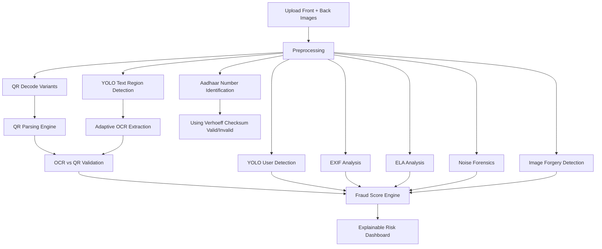

# 🛡️ Aadhaar Verification & Fraud Risk Intelligence System

<p align="center">
  
  
  
  
  
  
  
</p>

<p align="center">
  <b>AI-powered multi-layer Aadhaar fraud detection platform combining OCR, QR parsing, object detection, metadata forensics, ELA, and noise anomaly analysis — with explainable risk scoring.</b>
</p>

---

# 🚀 Executive Summary

This system is an **AI-driven document verification engine** designed to assess the authenticity of Aadhaar cards using a **multi-signal fraud intelligence pipeline**.

It does not rely on a single model.

Instead, it applies:

* 🔍 Computer Vision
* 📄 OCR Intelligence
* 📦 QR Payload Validation
* 🧠 Object-level Tamper Detection
* 🧬 Metadata Forensics
* 📊 Composite Risk Scoring
* 🧾 Explainable Fraud Indicators

The result:
A structured classification into:

* ✅ LOW FRAUD RISK
* ⚠️ MODERATE FRAUD RISK
* 🚨 HIGH FRAUD RISK

This is a **decision-support system**, not a blind classifier.

---

# 🧠 Core Problem Statement

Identity fraud impacts:

* KYC onboarding
* Fintech lending
* Telecom SIM activation
* Government subsidies
* EdTech & Hiring platforms

Manual document verification is:

* Time-consuming
* Error-prone
* Not scalable

This project demonstrates how AI + forensic heuristics can dramatically reduce manual workload and improve risk triaging.

---

# 🏗️ System Architecture



---

# 🔎 Multi-Layer Detection Strategy

## 1️⃣ OCR Intelligence

* YOLOv8 region detection for structured fields
* Adaptive Tesseract configurations
* Heuristic parsing fallback
* Aadhaar Verhoeff checksum validation
* Field normalization & sanitization

Extracted fields:

* Name
* Date of Birth
* Gender
* Aadhaar Number
* Address

---

## 2️⃣ QR Cross-Validation

* OpenCV QR detection
* Rotation & preprocessing variants
* XML / JSON parsing fallback
* OCR ↔ QR field consistency comparison

Mismatch between printed text and QR payload = fraud indicator.

---

## 3️⃣ Tamper Region Detection (YOLOv8)

Custom-trained object detection model flags:

* Tampered areas
* Edited sections
* Forged regions
* Manipulated overlays

Object-level detection adds strong fraud weight.

---

## 4️⃣ Metadata Forensics

Analyzes EXIF tags:

* Make
* Model
* Software
* DateTime
* DateTimeOriginal

Flags:

* Editing software traces
* Suspicious timestamp inconsistencies
* Missing structured metadata patterns

---

## 5️⃣ Error Level Analysis (ELA)

Detects:

* Recompression inconsistencies
* Localized editing artifacts
* Patch-based manipulation

ELA risk contributes 38% to composite forensic scoring.

---

## 6️⃣ Noise Anomaly Mapping

Analyzes:

* Local noise distribution
* Z-score irregularities
* Inconsistent pixel variance patterns

Noise anomalies suggest partial digital alteration.

---

# 📊 Fraud Scoring Engine

## Layer 1 — Rule-Based Fraud Score

Strong indicators increase `fraud_score`:

| Condition                | Impact |
| ------------------------ | ------ |
| OCR-QR mismatch          | +1     |
| Invalid Aadhaar checksum | +1     |
| Tampered region detected | +2     |
| Suspicious metadata      | +1     |

### Classification Logic

* `fraud_score >= 3` → 🚨 HIGH FRAUD RISK
* `fraud_score >= 1` → ⚠️ MODERATE FRAUD RISK
* else → ✅ LOW FRAUD RISK

---

## Layer 2 — Composite Image Forgery Score

Weighted blend:

| Signal                  | Weight |
| ----------------------- | ------ |
| ELA                     | 38%    |
| Noise                   | 32%    |
| Tamper Object Detection | 20%    |
| Metadata                | 10%    |

### Decision

* `>= 60` → Likely Forged
* `>= 32` → Needs Manual Review
* `< 32` → Likely Authentic

---

# 🗂 Repository Structure

```text
.
├── app.py
├── requirements.txt
├── train.py
├── yolov8n.pt
├── templates/
├── static/
│   └── analysis/
├── scripts/
├── pipeline/
├── dataset/
├── images/
└── LICENSE
```

---

# 🧰 Tech Stack

<p align="center">
  
</p>

### Core Technologies

* Python 3.9+
* Flask (Backend)
* PyTorch
* Ultralytics YOLOv8
* OpenCV
* Tesseract OCR
* NumPy / Pandas
* HTML / CSS / JS

---

# ⚙️ Installation

## Clone Repository

```bash
git clone https://github.com/venkat-0706/Aadhaar-Verification-System.git
cd Aadhaar-Verification-System
```

## Create Virtual Environment

```bash
python -m venv .venv
```

Activate:

**Windows**

```powershell
.\.venv\Scripts\Activate.ps1
```

**Linux/macOS**

```bash
source .venv/bin/activate
```

## Install Dependencies

```bash
pip install -r requirements.txt
```

## Install System Dependencies (Linux)

```bash
sudo apt install -y tesseract-ocr libzbar0
```

---

# ▶️ Run Application

```bash
python app.py
```

Open:

```
http://localhost:7860
```

---

# 📡 API Usage

### Endpoint

```
POST /analyze
```

### Example

```bash
curl -X POST http://127.0.0.1:7860/analyze \
  -F "file=@images/sample.jpg"
```

---

# 📤 Output Schema (High-Level)

```json
{
  "combined_ocr": {},
  "metadata_analysis": {},
  "ela_analysis": {},
  "noise_analysis": {},
  "image_forgery_detection": {},
  "fraud_indicators": [],
  "fraud_score": 2,
  "assessment": "MODERATE FRAUD RISK",
  "aadhaar_validation": {}
}
```

---

# 🎯 Engineering Highlights

* End-to-end ML pipeline orchestration
* Explainable AI risk modeling
* Multi-model integration
* Defensive fallback logic
* Production-style UI dashboard
* Practical fraud scoring design
* Dataset training + deployment integration

---

# ⚠️ Limitations

* Not a replacement for official UIDAI verification
* OCR sensitive to blur & glare
* Extremely advanced forgeries may evade heuristic detection
* Rule-based scoring needs dataset calibration for enterprise use

---

# 🔮 Future Roadmap

* Precision/Recall benchmarking
* Confusion matrix evaluation
* Model confidence calibration
* Multilingual OCR refinement
* Secure deployment with auth & rate limiting
* CI/CD + automated regression testing
* Active learning loop for false positives

---

# 🧑‍💼 For Recruiters & Reviewers

This project demonstrates:

* Applied Computer Vision in real-world fraud detection
* Multi-signal intelligence design
* Explainable scoring architecture
* Practical backend engineering
* ML model integration beyond toy examples
* System thinking across AI + forensics + UI

Start with:

* `app.py` → full orchestration logic
* `pipeline/` → modular forensic components
* `templates/results.html` → explainable risk reporting

---

# 📜 License

MIT License

---

# ⚖️ Disclaimer

This software is intended for research and assisted-verification purposes only.
It must not be used as the sole basis for legal or governmental identity decisions without human review.


